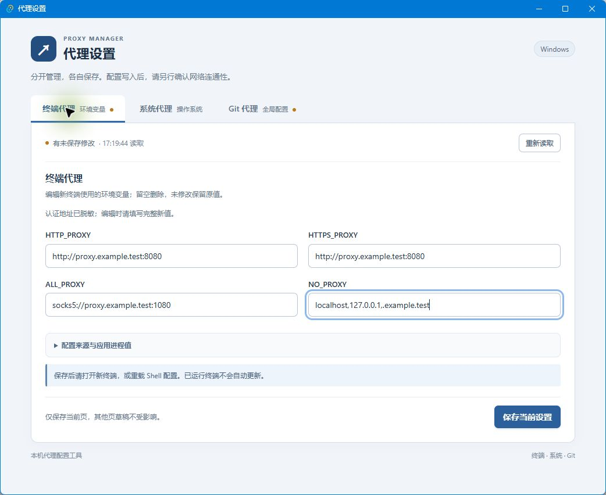
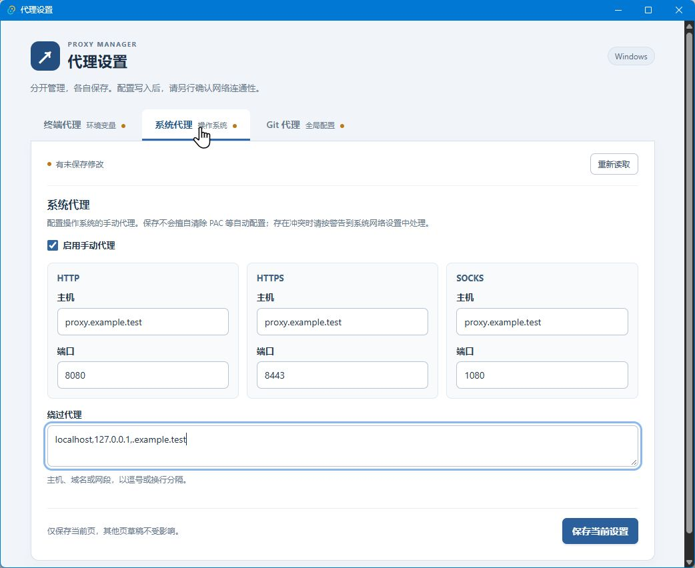
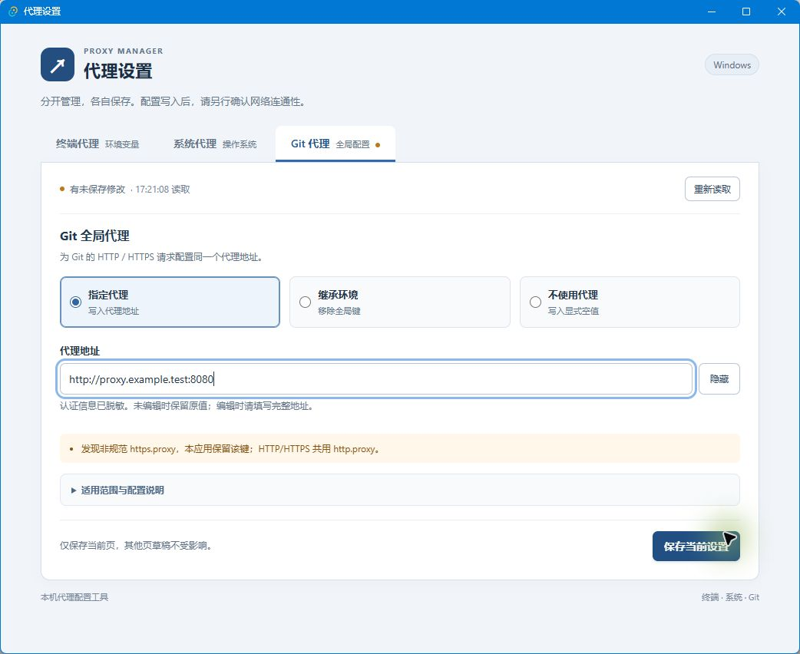

# Proxy Manager

<p align="center">
  <strong>Manage terminal, system, and Git proxy settings from one focused desktop workspace.</strong><br />
  Built with Tauri 2, Vue 3, TypeScript, and Rust. Each tab reads, edits, and saves its own configuration.
</p>

<p align="center">
  <a href="README.md">中文</a>
</p>



> The screenshots use synthetic values such as `proxy.example.test`. They show the current application UI only; the example values were not saved and did not change the machine's network settings.

## Why Proxy Manager

Proxy settings are often split across shell environment variables, operating-system settings, and Git configuration. Proxy Manager brings those three surfaces into one window while keeping their save boundaries, source hints, and read-back results visible, so you can verify which configuration is actually being managed.

- **Terminal proxy**: inspect process and persisted values for `HTTP_PROXY`, `HTTPS_PROXY`, `ALL_PROXY`, and `NO_PROXY`.
- **System proxy**: edit HTTP, HTTPS, and SOCKS manual proxies plus the bypass list.
- **Git proxy**: choose between a custom proxy, inheriting the environment, or explicitly disabling the global proxy.
- **Safe editing**: mask credentials, validate before saving, read back after saving, and keep unsaved drafts isolated per tab.
- **Cross-platform adapters**: Windows user environment variables and WinINet; macOS shell, launchd, and network-service settings; a clear unsupported response on Linux.

## The three tabs

| Terminal proxy | System proxy | Git proxy |
| --- | --- | --- |
|  |  |  |

Each tab saves only its own settings. Switching tabs does not overwrite another draft. Reloading asks before discarding unsaved edits; failed saves keep the draft and report a recoverable error or partial result.

## Install and run

You need Node.js 22.12+, pnpm 10, Rust stable, and the platform prerequisites for [Tauri 2](https://v2.tauri.app/start/prerequisites/). Windows also requires the MSVC C++ build tools and WebView2.

```sh
git clone https://github.com/leongaooo/proxy-manager.git
cd proxy-manager
pnpm install --frozen-lockfile
pnpm tauri dev
```

`pnpm dev` starts the frontend only. Full operating-system read/write behavior requires `pnpm tauri dev`.

## Git global proxy semantics

The Git tab manages only the global `http.proxy` key through separate `git config --global` arguments; it never builds a shell command.

| Mode | Write behavior |
| --- | --- |
| Custom proxy | Set `http.proxy` to the complete proxy URL |
| Inherit environment | Remove global `http.proxy` and let Git select a proxy from its normal precedence and environment variables |
| No proxy | Set `http.proxy` to an explicit empty string |

`http.proxy` applies to both HTTP and HTTPS transports. System, repository, worktree, command-line, `http.<url>.proxy`, and `remote.<name>.proxy` settings can still affect the final behavior; this tool does not edit those other sources.

## Platforms and limits

| Platform | Scope | Verification |
| --- | --- | --- |
| Windows | User environment variables and WinINet manual proxy | Windows x64 has been verified on real hardware; automated tests cover fake adapters, temporary Git configuration, and an isolated registry, but do not prove proxy connectivity |
| macOS | Default shell, launchd, and network-service proxy | Platform adapters and tests are included; no macOS hardware verification was performed for 0.2.0 |
| Linux | Not supported yet | The platform entry returns an unsupported response |

Saving a setting does not prove that a proxy server is reachable or that every application will honor the system proxy. Already-running terminals and applications may keep their old environment until restarted. PAC, automatic discovery, and proxy authentication have protection limits; follow the specific UI message. Saves can complete partially and do not provide cross-section transaction rollback. Record the previous configuration before changing it; macOS users should also back up their shell configuration.

## Checks and packaging

```sh
pnpm test
pnpm format:check
pnpm build
cargo test --manifest-path src-tauri/Cargo.toml
cargo fmt --manifest-path src-tauri/Cargo.toml -- --check
```

```sh
# Windows NSIS installer
pnpm tauri build --bundles nsis

# macOS app and disk image (run on macOS)
pnpm tauri build --bundles app,dmg
```

Build artifacts are written to `src-tauri/target/release/bundle/` and are not committed. Handle code signing and macOS notarization as required before distributing a build.

## Project layout

```text
src/
  api/              Tauri invocation boundary
  components/       Forms and save results
  composables/      Draft, read, and save orchestration
  generated/        TypeScript contracts exported by ts-rs
  __tests__/        Frontend tests
src-tauri/src/
  contracts.rs      Rust data contracts
  rules.rs          Input validation and pure transforms
  service.rs        Section-level save and read-back for terminal/system settings
  git_proxy.rs      Git global proxy read, conflict protection, and save
  platform/         Windows / macOS adapters
```

`src/generated/` is generated by the Rust contract tests. Change the Rust contract first and run the tests; do not edit generated types manually.

## Contributing and license

Issues and pull requests are welcome. Include the operating system, app version, reproduction steps, and expected behavior. Never include proxy passwords, access tokens, or private network settings in issues, logs, or screenshots.

[MIT](LICENSE). Third-party dependencies and trademarks remain subject to their respective licenses and terms.
