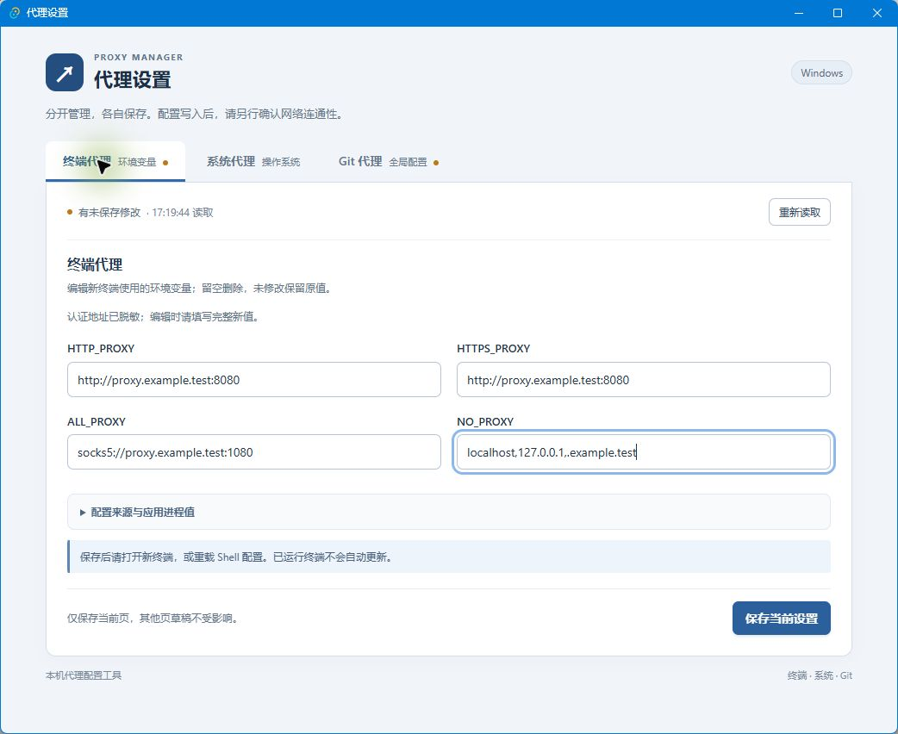
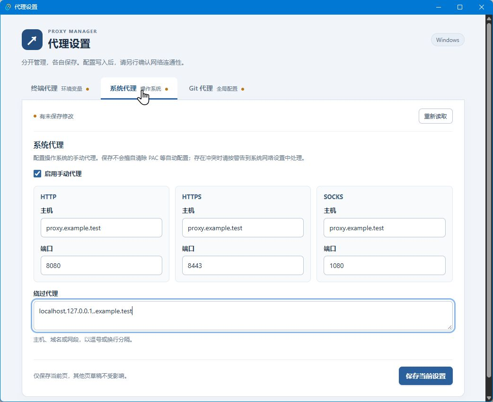
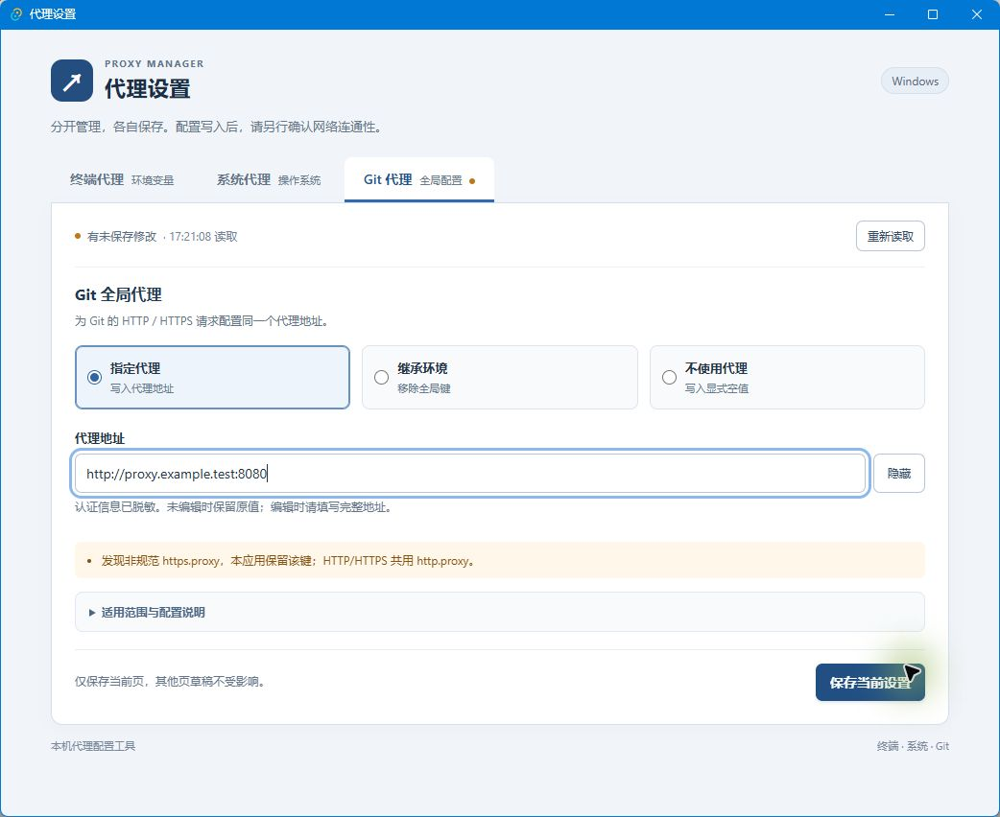

# Proxy Manager · 代理设置

<p align="center">
  <strong>把终端、系统和 Git 代理放在一个清晰的桌面工作区里。</strong><br />
  基于 Tauri 2、Vue 3、TypeScript 与 Rust，轻量、跨平台，按页签独立读取、编辑和保存。
</p>

<p align="center">
  <a href="README.en.md">English</a>
</p>



> 截图使用 `proxy.example.test` 等合成地址，仅展示当前应用界面；示例值未保存，也不会修改本机网络设置。

## 为什么使用它

代理问题经常分散在 Shell 环境、操作系统设置和 Git 全局配置中。Proxy Manager 将三类配置放进同一窗口，同时保留各自的保存边界、来源提示和回读结果，让“当前到底用了哪套代理”更容易核对。

- **终端代理**：查看进程值与持久化值，编辑 `HTTP_PROXY`、`HTTPS_PROXY`、`ALL_PROXY`、`NO_PROXY`。
- **系统代理**：设置 HTTP、HTTPS、SOCKS 手动代理和绕过列表。
- **Git 代理**：在指定代理、继承环境、不使用代理三种模式之间切换，管理全局 `http.proxy`。
- **安全边界**：认证信息脱敏展示；保存前校验，保存后回读；未保存草稿按页签隔离。
- **跨平台适配**：Windows 支持用户环境变量与 WinINet；macOS 支持 Shell、launchd 和网络服务代理；Linux 返回不支持提示。

## 三个页签

| 终端代理 | 系统代理 | Git 代理 |
| --- | --- | --- |
|  |  |  |

每个页签只保存自己的设置，切换页签不会覆盖其他草稿。重新读取遇到未保存修改时会先确认；保存失败会保留草稿并显示可恢复的错误或部分完成结果。

## 安装与运行

需要 Node.js 22.12+、pnpm 10、Rust stable，以及对应平台的 [Tauri 2 系统依赖](https://v2.tauri.app/start/prerequisites/)。Windows 还需要 MSVC C++ 构建工具和 WebView2。

```sh
git clone https://github.com/leongaooo/proxy-manager.git
cd proxy-manager
pnpm install --frozen-lockfile
pnpm tauri dev
```

`pnpm dev` 只启动前端页面；读写操作系统配置需要使用 `pnpm tauri dev`。

## Git 全局代理的写入语义

Git 页只管理全局 `http.proxy`，通过独立参数调用 `git config --global`，不会拼接 Shell 命令。

| 模式 | 写入语义 |
| --- | --- |
| 指定代理 | 设置 `http.proxy` 为完整代理 URL |
| 继承环境 | 删除全局 `http.proxy`，让 Git 按配置优先级和环境变量选择代理 |
| 不使用代理 | 将 `http.proxy` 设置为空字符串 |

`http.proxy` 同时适用于 HTTP 和 HTTPS 传输。系统级、仓库、worktree、命令行、`http.<url>.proxy` 和 `remote.<name>.proxy` 等更高优先级或其他来源仍可能影响最终行为；本工具不会编辑这些覆盖项。

## 平台与限制

| 平台 | 实现范围 | 验证说明 |
| --- | --- | --- |
| Windows | 用户环境变量、WinINet 手动代理 | Windows x64 已完成真实验收；自动化测试覆盖 fake 适配、临时 Git 配置与隔离注册表，但不等于代理连通性验收 |
| macOS | 默认 Shell、launchd、网络服务代理 | 包含平台适配和测试；0.2.0 尚未做 macOS 真机验证 |
| Linux | 暂不支持 | 平台入口返回不支持提示 |

保存配置不代表代理服务器可用，也不代表每个应用都会采用系统代理。修改持久化环境变量后，已启动的终端和应用可能仍持有旧环境，需要重新启动。PAC、自动发现和代理认证存在保护限制，请按界面提示处理。保存可能部分完成且不提供跨区块事务回滚；更改前建议记录原有配置，macOS 用户还应备份 Shell 配置文件。

## 检查与打包

```sh
pnpm test
pnpm format:check
pnpm build
cargo test --manifest-path src-tauri/Cargo.toml
cargo fmt --manifest-path src-tauri/Cargo.toml -- --check
```

```sh
# Windows NSIS 安装包
pnpm tauri build --bundles nsis

# macOS 应用与磁盘镜像（在 Mac 上运行）
pnpm tauri build --bundles app,dmg
```

产物默认位于 `src-tauri/target/release/bundle/`，不会随源码提交。发布前请自行处理适用的代码签名和 macOS 公证。

## 代码结构

```text
src/
  api/              Tauri 调用边界
  components/       表单与保存结果
  composables/      草稿、读取与保存编排
  generated/        ts-rs 导出的 TypeScript 契约
  __tests__/        前端自动化测试
src-tauri/src/
  contracts.rs      Rust 数据契约
  rules.rs          输入校验与纯转换
  service.rs        终端与系统按区块保存及回读
  git_proxy.rs      Git 全局代理读取、冲突保护与保存
  platform/         Windows / macOS 平台适配
```

`src/generated/` 由 Rust 契约测试导出。修改契约时请先改 Rust，再运行测试，不要手动维护生成类型。

## 贡献与许可证

欢迎通过 Issue 报告问题或提交 Pull Request。请附上操作系统、应用版本、复现步骤和预期行为；不要在 Issue、日志或截图中包含代理密码、访问令牌或私人网络配置。

[MIT](LICENSE)。第三方依赖及其商标遵循各自的许可证和使用条件。
